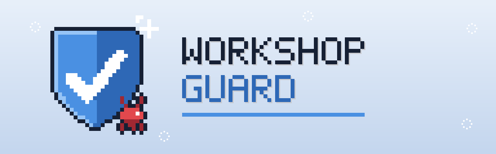

<p align="center"></p>

<p align="center">
  
  
  
  
  <a href="https://github.com/CammyCodes/WorkshopGuard/actions"></a>
</p>

**WorkshopGuard** scans Steam Workshop mods for malware. Pick a game, start it in Docker, and every new upload and
every update gets checked by up to ten engines. Dodgy ones are reported to Discord, and can be moved out of your
own Steam folder before the game loads them.

Workshop malware is real now: in 2026 it hit People Playground (twice), PlateUp! and Project Zomboid. Valve doesn't
scan mod code, so WorkshopGuard lets anyone who cares about a game watch it.

## What it does

- **Watches a game's Workshop** for new items and updates (a good mod turning bad in an update is the usual trick),
  and can scan everything already there.
- **Scans each mod with many engines**: ClamAV, WorkshopGuard's own rules for Workshop malware, YARA Forge's community
  rules, Mandiant's capa, a .NET mod analyzer, Windows program checks and per-game file checks, plus VirusTotal,
  MetaDefender and MalwareBazaar if you add free keys.
- **Protects your PC**: point it at Steam's Workshop folder and new or updated mods are scanned as Steam installs
  them. Malicious ones are moved to quarantine.
- **Tells you why**: plain-English reasons per verdict, alerts to Discord or any webhook, and a local dashboard.
- **Lets game developers act**: ban bad items from their own game's Workshop for everyone, and give the game a
  blocklist so it refuses to load them.

Downloaded files are only ever read, never run, inside a locked-down container.

## Quick start

You need Docker on a machine that's always on (a VPS, home server or your PC) with an x86-64 CPU and about 2 GB of RAM.

```bash
git clone https://github.com/CammyCodes/WorkshopGuard.git
cd WorkshopGuard
cp .env.example .env
```

In `.env`, set the game, by name or by the number in its store URL (`store.steampowered.com/app/1599600/...`), and
optionally where alerts go:

```ini
GAMES=plateup                # or GAMES=1599600, or several: GAMES=plateup,bo3
DISCORD_WEBHOOK_URL=         # Discord channel > Integrations > Webhooks > Copy URL
STEAM_WORKSHOP_DIR=          # optional, protect your PC: .../steamapps/workshop/content
```

```bash
docker compose up -d
docker compose run --rm guard selftest     # plants a harmless fake detection and checks every step
```

The dashboard is at <http://localhost:8080>.

**Some games need a Steam account.** Black Ops III and Left 4 Dead 2 let anyone download Workshop items, but PlateUp!
and Teardown only serve them to an account that owns the game. WorkshopGuard tells you when that's the case. Set
`STEAM_USERNAME` in `.env`, then log in once (you type the password and approve Steam Guard yourself):

```bash
docker compose run --rm guard login     # Windows: .\scripts\steam-login.ps1
```

## Set it up with Claude

Paste this into [Claude Code](https://claude.com/claude-code) and it'll do the setup with you:

```text
Set up WorkshopGuard (https://github.com/CammyCodes/WorkshopGuard) for me: a Docker service that scans Steam
Workshop mods for malware.

1. Check Docker is installed and running. If it isn't, tell me how to install it and stop.
2. Clone the repo, copy .env.example to .env, and read the README.
3. Ask me which game(s) to watch (a name or Steam app ID), and whether I want alerts in Discord (I'll paste a
   webhook URL) and protection for the mods on this PC (find my Steam workshop/content folder and confirm it).
   Fill those into .env. Leave BACKFILL=none unless I ask to scan everything already on the Workshop.
4. Run `docker compose up -d`, then `docker compose run --rm guard selftest <game>`.
5. If the self-test says the game needs an account that owns it: ask for my Steam account name, put it in
   STEAM_USERNAME, and run `docker compose run --rm guard login` in a terminal I can type in. Never ask for, type
   or store my password or Steam Guard code: I enter those myself. Then run the self-test again.
6. Show me the dashboard at http://localhost:8080 and tell me in two lines what's running and what each alert
   means. Don't commit, push or publish anything.
```

## Deep scans

To throw everything at one mod:

```bash
docker compose run --rm guard deep-scan plateup 3819935407
```

That runs every engine available and prints what each one said. `--upload` also sends files VirusTotal and
MetaDefender have never seen for a full scan (off by default, since uploads are shared with security vendors).

| Engine | What it catches | Needs |
|---|---|---|
| ClamAV | Known malware signatures, updated daily | – |
| WorkshopGuard rules | Steam/Discord/browser account theft, webhook exfiltration, droppers, wipers, persistence, Lua and C# backdoors, mods that republish themselves or message your friends | – |
| YARA Forge | Thousands of community rules for known malware families | – |
| capa (Mandiant) | Hostile capabilities in programs: keylogging, screenshots, persistence, destruction | – |
| .NET mod analysis | What a Unity/C# mod's code calls, and the combinations malware needs (download + run, read secrets + send) | – |
| Windows program checks | Dangerous imports, packers, programs disguised as images | – |
| File checks | Anything out of place for that game: an `.exe` in a map, a `.bat`, a locked archive, copycat titles | – |
| VirusTotal | ~70 antivirus engines | free key |
| MetaDefender | ~20 antivirus engines | free key |
| MalwareBazaar | abuse.ch's database of known malware | free key |

## For game developers

Run it on your own game with a Steamworks **publisher key** and it can take items off your Workshop for everyone:

```ini
PUBLISHER_KEY=...          # Steamworks > Users & Permissions > Manage Groups > Web API key
PUBLISHER_APPS=1599600     # the only apps it may act on
ADMIN_PASSWORD=...         # protects the dashboard and its Ban buttons
AUTO_BAN=off               # off: you review and click Ban · confirmed: auto-ban when a known-malware engine agrees
```

The dashboard gets a **review queue** and **Ban item / Ban uploader / Unban** buttons, and every action is logged and
posted to your alert channel. Bans are reversible and nothing is ever deleted. Players who already downloaded a banned
mod may still have it, so WorkshopGuard also serves a **blocklist** (item IDs and the flagged files' hashes) for your
game to check before loading mods. Setup, auto-ban rules and a C# example: [docs/FOR_GAME_DEVELOPERS.md](docs/FOR_GAME_DEVELOPERS.md).

## What it can't do

No scanner catches everything, and WorkshopGuard is no exception. It reads mods without running them, so:

- Brand-new tricks that no rule describes yet can get past it.
- A mod can download its real payload *after* it's been scanned. WorkshopGuard flags the "download, then run or load
  code" pattern that needs, but a well-hidden one can slip through.
- Protect mode scans mods as Steam installs them. If the game starts in the same few seconds, it may load a mod first.

Treat **malicious** as "remove it now and report it to Valve", **suspicious** as "a person should look", and
**clean** as "nothing found", not "guaranteed safe". Please check before accusing a mod author publicly.

## Commands

`docker compose run --rm guard <command>`:

| | |
|---|---|
| `watch` | The default: watch, scan and alert forever |
| `selftest [game]` | Fake detection end to end, including the alert |
| `deep-scan <game> <id>...` | Every engine on specific mods (`--upload`, `--inject-test`) |
| `scan-item <game> <id>...` | Scan specific mods with your normal engines |
| `scan-path <game> <folder>` | Scan mods already on disk (`--deep`) |
| `protect [--once]` | Only guard the mods on this PC |
| `login` | Log SteamCMD in once, for games that need an account |
| `ban` · `unban` · `ban-uploader` · `blocklist` | Game developers: moderate your own Workshop |
| `list <game>` · `status` · `rescan --all` | Newest items · flagged items · scan everything again |

Every setting is explained in [`.env.example`](.env.example). Your own YARA rules go in `custom-rules/`.

## Development

```bash
sh tests/build_fixtures.sh   # an inert fake "stealer" mod and a booby-trapped fake BO3 map
docker compose run --rm --entrypoint sh -v ./tests:/app/tests:ro guard -c "pip install -q --user pytest && python -m pytest -q /app/tests"
```

`docker-compose.test.yml` adds a local webhook receiver for testing alerts. The fixtures aren't malware: nothing in
them is ever called, and every address is on the reserved `.invalid` domain. The banner is drawn by
`tools/logo/make_logo.py`.

## Licence

MIT. Made by CammyCodes.
