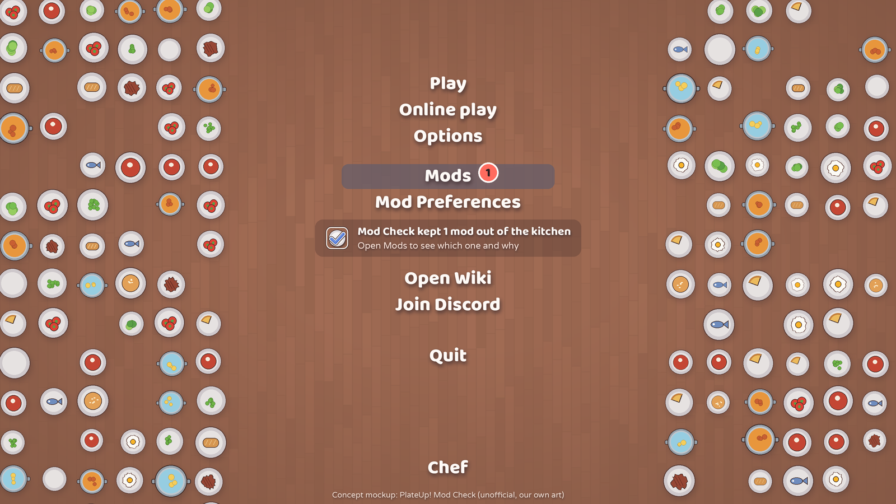
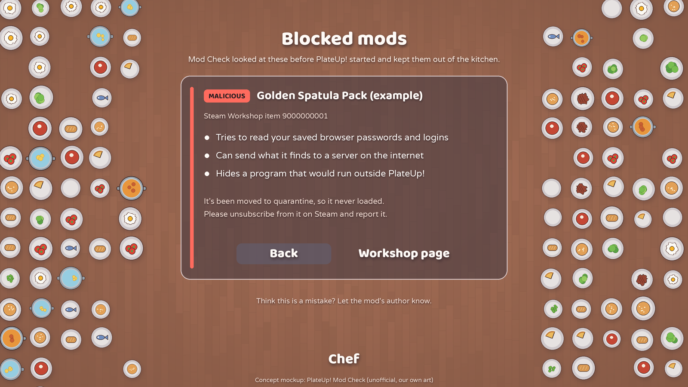
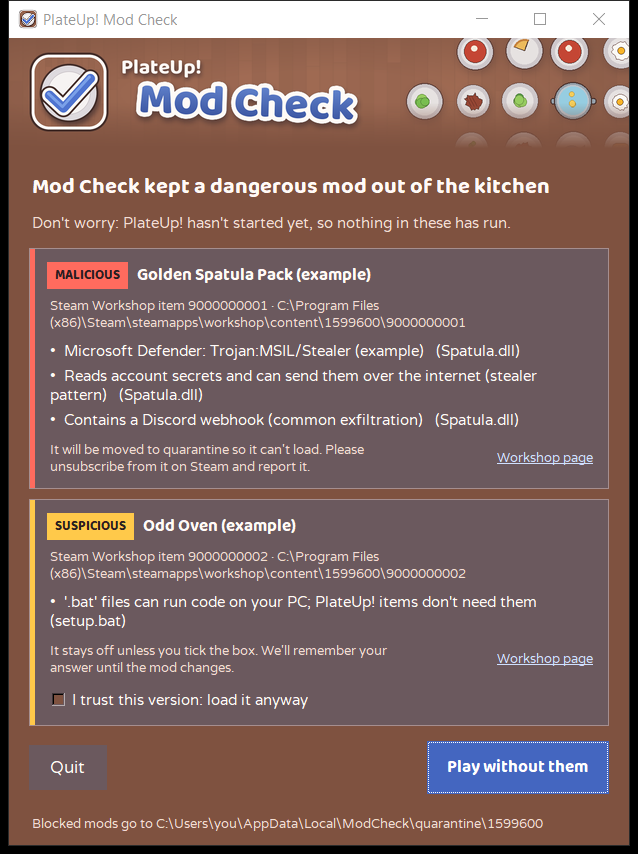
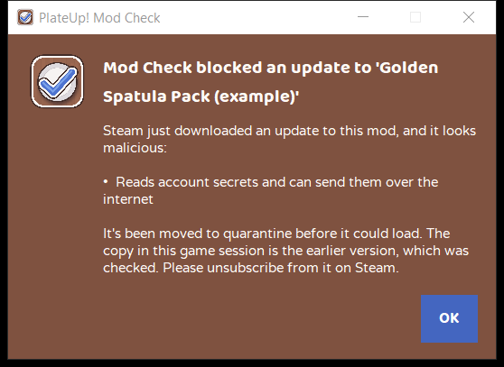
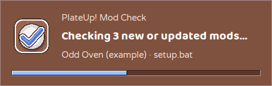

# PlateUp! Mod Check: a theme concept

This folder is a complete look for the mod-safety check that runs before PlateUp! loads its mods: colours, fonts,
artwork and every sentence a player reads. It's a **concept**, made by a fan and **not official** or endorsed by
It's Happening. The PlateUp! team is welcome to adopt any of it, change it, or ignore it.

Everything here is original. The table, plates, tick and lettering are drawn in code by `tools/make_art.py`. No game
asset, logo, sprite, screenshot or font from PlateUp! is in this folder. The colours were *sampled* from the game's
menus so the windows feel at home next to it.





These two show how the game itself could tell players about a blocked mod, in its own menu style. The windows below
are the real launch-gate windows using this theme (`preview/`, made by `tools/preview_windows.py`).

| Decision dialog | Alert | Progress |
|---|---|---|
|  |  |  |

## The idea

The game's menus are a warm wooden table covered in plates, with chunky white text and a soft greyish-purple
highlight on whatever you've picked. Mod Check borrows that table: the window is the table, each flagged mod sits on
its own highlight-coloured card, and the mark is a clean plate with a big friendly tick, because a checked plate is
a safe plate.

## Palette

| Token | Hex | Where | Contrast |
|---|---|---|---|
| `bg` | `#7f5240` | Window background: the table, a shade deeper than the game's `#9c6851` so white text reads | text 6.36, dim 5.06 |
| `card` | `#6b595e` | Mod cards: the menu's grey-purple highlight laid over the table | text 6.30, dim 5.00 |
| `border` | `#a58e8f` | Card and progress-window outline, like a plate rim | (outline only) |
| `text` | `#fffaf6` | Titles and body text: the warm white of the game's menu text | see above |
| `dim` | `#f3ddd3` | Subtitles, paths, notes | see above |
| `malicious` | `#ff6b5e` | Tomato red: badge and card stripe | badge text 5.79 |
| `suspicious` | `#ffc94a` | Cheese yellow: badge and stripe | badge text 10.55 |
| `game` | `#9cc0ff` | Plate blue: game-files badge and stripe | badge text 8.77 |
| `badge_text` | `#2b1d20` | Text on all three badges | see above |
| `primary` / `primary_hover` | `#4466c0` / `#3a5aae` | Play button: the blue of a chunky title, deepened | white 5.37 / 6.45 |
| `primary_text` | `#ffffff` | Play button text | |
| `secondary` / `secondary_hover` | `#6b595e` / `#806b71` | Quit, Repair: the menu highlight | text 6.30 / 4.76 |
| `secondary_text` | `#fffaf6` | Their text | |
| `link` | `#cfe0ff` | "Workshop page" on cards | 4.90 on card |
| `progress` / `progress_trough` | `#9cc0ff` / `#5a3829` | Progress bar | 5.61 |

Every text pair meets WCAG AA (4.5:1). Run `python tools/check_contrast.py` after changing a colour; it fails if a
text pair drops below 4.5. Two non-text pairs sit under 3:1 on purpose: the tomato stripe on a card (2.34; the
badge beside it says MALICIOUS in 5.79:1 text) and the blue Play button against the table (1.23; its label is
5.37:1). Sampled from the game: table `#9c6851` to `#835744` at the edges, highlight `#746064` over the table,
text shadow `#524443`, a blue title from `#6fa1e8` to `#5b649e` with a `#fff9f7` outline.

## Type

- **Baloo 2 Bold** (headings, buttons, badges). Round, chunky and cheerful, the closest open font in spirit to the
  game's menu lettering. Baloo 2 ExtraBold is only used by `make_art.py` for the big menu text in the mockups.
- **Varela Round** (body). Baloo is lovely large but small at 8 to 9pt, so body text uses Varela Round: rounded
  ends that match, and clear at small sizes.

Both are static TTFs under the SIL Open Font License (`fonts/OFL-*.txt`), from the official sources: Baloo 2 from
Ek Type's GitHub release 1.640, Varela Round from Google Fonts. They're loaded privately by the window (nothing is
installed on the player's PC). Baloo 2 has tall line spacing, so a two-line title takes a little more room.

## Voice

Friendly, calm, plain. A light kitchen flavour where it helps, never where it could confuse.

- **Say what happened first, then what to do.** "Mod Check kept a dangerous mod out of the kitchen" then
  "Don't worry: PlateUp! hasn't started yet, so nothing in it has run."
- **Kitchen words are seasoning, not the meal.** "Kept out of the kitchen" works because "dangerous mod" sits right
  next to it. The badges stay plain: MALICIOUS, SUSPICIOUS, GAME FILES.
- **No jokes about a malicious mod.** Its card says exactly what it does and what happens next: "It will be moved to
  quarantine so it can't load. Please unsubscribe from it on Steam and report it."
- **Give the player the choice and remember it.** "It stays off unless you tick the box. We'll remember your answer
  until the mod changes."
- **Never overpromise.** We say a mod looks malicious and what was found, and the safe choice when we couldn't check:
  "Your mods haven't been checked, so the safe choice is to quit and try again."
- British spelling, sentence case, short sentences, "you" and "we".

All the text is in `theme.json` under `strings`. `{game}`, `{short}`, `{n}`, `{id}`, `{path}`, `{mod}`, `{reasons}`,
`{folders}`, `{error}`, `{log}` and `{kept}` are filled in by the window, so keep them as they are.

## Components

- **Progress window**: borderless, logo on the left, the product name small, the heading in Baloo, and a light-blue
  bar on a dark-wood trough. Only appears if checking takes a moment.
- **Decision dialog**: the header strip (`art/header.png`, 620x110: table, plates, the mark and "Mod Check"
  lettering) melts into the window background. Below it: title, reassurance line, then one card per flagged mod: a
  coloured stripe, a badge, the mod's name, where it lives, up to four reasons, a note on what happens, a Workshop
  link and, for suspicious mods, the "I trust this version" tickbox. Quit sits on the left in the highlight colour;
  Play is the blue button on the right and changes to "Play without it/them" while anything is held back.
- **Alerts**: the logo, a title in Baloo, plain body text, buttons with the default in blue.
- **In-game ideas** (the mockups): a red count bubble on Mods with a two-line note under it, and a Blocked mods
  panel built from the same pieces: the highlight as a panel, the tomato stripe and badge, plain-English reasons,
  Back and Workshop page as menu items.

## Making it your own

- **Your logo**: replace `art/logo.png` (512x512 PNG; the windows show it at 64x64, so bold shapes win) and
  `art/icon-32.png` (window icon). For the dialog header, replace `art/header.png` (620x110), or delete the
  `"header"` line from `theme.json` and the dialog shows the logo beside the title instead.
- **Your font**: put a *static* `.ttf` in `fonts/` (Windows only uses the default style of a variable font), list it
  in `fonts.files`, and set `fonts.body` / `fonts.heading` to its family name as Windows sees it. If the name is
  wrong, the window quietly falls back to Segoe UI.
- **Your colours and words**: edit `theme.json`, then run `python tools/check_contrast.py`.
- **Redraw the art** with `python tools/make_art.py` (needs Pillow); it reads the colours and names from `theme.json`.
  `python tools/preview_windows.py` (Windows) opens the real windows with made-up mods and saves `preview/`.

## Files

```
theme.json            colours, fonts, images, every player-facing sentence
art/                  logo.png (512), icon-32.png, icon-256.png, header.png (620x110)
fonts/                Baloo2-Bold.ttf, Baloo2-ExtraBold.ttf, VarelaRound-Regular.ttf, OFL-Baloo2.txt, OFL-VarelaRound.txt
mockups/              main-menu-notice.png, blocked-mods-panel.png (1600x900 concepts)
preview/              the real windows in this theme
tools/                make_art.py, check_contrast.py, preview_windows.py
```
