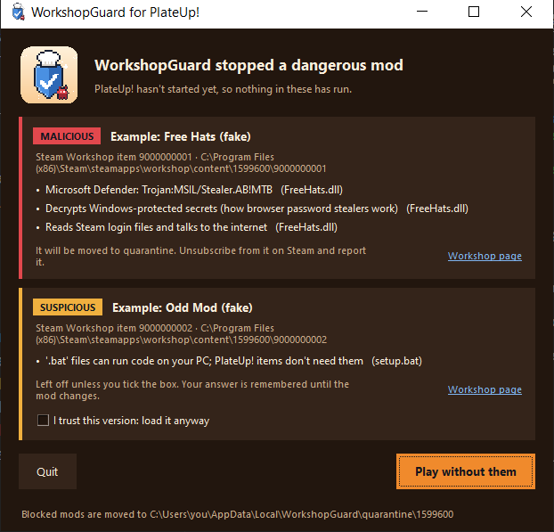

<p align="center"></p>

# WorkshopGuard for PlateUp!

After the PlateUp! Workshop malware in October 2026, WorkshopGuard checks every PlateUp! mod on your PC **before the
game starts**, so nothing in a mod gets to run first. It's free and open source, made by a PlateUp! modder
([CammyCodes](https://github.com/CammyCodes): Chef's Kiss, Pho, Realistic Coffee Prices, Crossover).

> Unofficial and community-made. Not made by or affiliated with It's Happening or Yogscast Games.

## For players

Most launches you won't notice it: if your mods haven't changed, PlateUp! starts in about half a second, with no
window. When Steam installs a new mod or an update, a small window shows while just the changed files are checked.
If one looks dangerous, it's moved out of the way before PlateUp! can load it, and you're told why.

<p align="center"></p>

**Install (Windows):** get Python 3.10+ from [python.org](https://www.python.org/downloads/), download this repository
(Code > Download ZIP, and unzip it somewhere permanent), then in that folder:

```powershell
powershell -ExecutionPolicy Bypass -File scripts\install-gate.ps1
```

It checks your mods once and gives you a line to paste into Steam: right-click PlateUp! > Properties > Launch Options.
From then on, press Play in Steam as usual. Full details: [GATE.md](GATE.md).

## For the PlateUp! team

Hi! This is a toolkit you're welcome to use, recommend, borrow from or ignore. Everything here reads mods without
running them, and nothing in it touches your servers or your game files.

### What the launch gate does on a player's PC

1. **Hashes every mod file in full on every launch**: all subscribed items and `PlateUp/Mods`, about 40 ms for a
   typical setup. Anything exactly as it was at its last clean check is let straight through.
2. **Scans only what changed**, with results cached per file: WorkshopGuard's rules for Workshop malware (stealers,
   droppers, webhook exfiltration, Workshop worms), ~5,000 YARA Forge community rules, a .NET analyzer that reads a
   mod's metadata for the combinations malware needs (download + run, read Steam/Discord secrets + send), Windows
   program checks and Microsoft Defender.
3. **Quarantines dangerous mods before the game starts**, remembers their files so a re-download or a re-upload of
   the same payload under a new item ID is stopped instantly, and lets the player decide on suspicious ones.
4. **Holds the files the game will load** so nothing can swap them after the check, then reads `Player.log` until
   `Loaded N mods...` to confirm PlateUp! only loaded folders it checked. If it didn't, the game is closed.
5. **Notices PlateUp!'s own DLLs changing** without a Steam update, and DLL-hijack files (`winhttp.dll` and friends)
   appearing next to `PlateUp.exe`.

Tested against build 26000811 with the real game. All nine mods on our test PC (HarmonyX, KitchenLib,
PreferenceSystem and others) come out clean. A planted test mod was quarantined, and the game started 0.6 s after Play
with it gone.

### What we noticed in the mod loader (build 26000811)

From reading `KitchenMods.dll`, in case it's useful:

- `SteamWorkshopModSource` skips every item with an ID above 3820868888. That stops new uploads, but it also stops
  every good mod published after that point from loading. On our PC, PlateUp! found 9 Workshop mods and loaded 8: our own
  Crossover (3826137276) was skipped. A blocklist check (below) could let good new mods back in.
- Items containing a `.bat` are skipped, and the two pinned mods (Harmony, KitchenLib) must match their signature.
  Every other mod's DLLs are loaded with `Assembly.Load(bytes)` with no other check.
- `-nomods` turns mods off. The gate uses it if it can't move a bad mod out of the way.

### Three ways to use it

1. **Build it into the game (recommended): [ModGuard](../modguard/README.md).** The same checks in plain C# (.NET
   Standard 2.0, C# 7.3, no dependencies), called from the mod loader before each mod loads. Paste in
   [`ModSafetyCheck.cs`](../modguard/samples/PlateUp/ModSafetyCheck.cs), then add about six lines to
   `SteamWorkshopModSource`, `FolderModSource` and `ModPreload`:

   ```csharp
   Mod refused = ModSafetyCheck.Refuse(item.Directory, item.Id.Value, name, this);
   if (refused != null) { list.Add(refused); continue; }
   ```

   A refused mod becomes a `FailedDuringLoad` mod, the same way a pinned mod with a bad signature is refused, and none
   of its code is loaded. It hashes every file, analyses only new ones (the .NET analyzer and file checks, giving the
   same answers as the Python engine on 583 real programs), asks the player's antivirus through Windows AMSI, and
   can check a blocklist. Tested inside PlateUp! build 26000811: about 0.4 s for nine mods once cached, and the fake
   stealer refused.
2. **Point players at the launch gate** (the top of this page). No change to the game.
3. **Run WorkshopGuard as a service** on your Workshop: it scans every new upload and update with every engine (YARA,
   ClamAV, capa...). With a Steamworks publisher key it can ban bad items (reversibly, never deleting) and publish
   the **blocklist** ModGuard reads. See [FOR_GAME_DEVELOPERS.md](FOR_GAME_DEVELOPERS.md).

With 1 and 3 together, the blanket "item ID above 3820868888" cut-off could go and new mods could load again.

### Privacy

The gate runs on the player's PC. Its only network calls are the blocklist (if one is configured) and Steam's public
Workshop details API for mod titles. Online scanners (VirusTotal and others) are off unless the player adds their own
keys, and even then they send only file hashes.

### Honest limits

No scanner catches everything. A brand-new trick that no rule describes can get past, and so can a mod that downloads
its real payload later (the gate flags the "download, then run or load code" pattern that needs). The gate also
guards launches that go through Steam: running `PlateUp.exe` directly skips it, because PlateUp! doesn't restart
itself through Steam. The optional `guard` mode covers that by checking mods as Steam installs them.

### Get in touch

Questions, ideas or anything you'd like changed: open an issue on
[github.com/CammyCodes/WorkshopGuard](https://github.com/CammyCodes/WorkshopGuard/issues). Happy to help wire any of
it in.

Made by CammyCodes. MIT licence.
